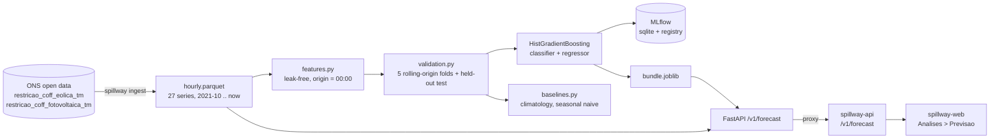

# spillway-forecast

Hourly **risk of wind/solar curtailment** (energy cut by the Brazilian grid operator ONS) for the
next 7 days, per state / subsystem and source, with honest temporal validation, MLflow tracking and a
FastAPI service that the Spillway API and web app can call.

> Curtailment ("constrained-off", *corte de geração*) is energy that wind and solar plants could
> have produced but were told not to. Knowing which hours are likely to be cut is useful to
> traders, plant operators and analysts. This project predicts, for every hour of the next 7 days:
> the probability that the hour loses at least 10% of its potential output (the **risk**) and the
> expected curtailment percentage.

## Architecture



## Data

* Source: ONS open data (`ons-aws-prod-opendata`), the same datasets that feed `energia-data`
  (the Airflow pipeline / warehouse). 30-minute rows per wind or solar cluster, monthly parquet.
* Definitions match the warehouse: curtailed MWh = `max(val_geracaonaorealizadaapurada, 0) * 0.5`,
  generation MWh = `val_geracao * 0.5`. `spillway reconcile` compares our monthly state sums with
  `state_monthly_curtailment` (read-only `SELECT`).
* Raw files are aggregated on download into **hourly rows per state, subsystem and SIN**
  (`data/processed/hourly.parquet`, ~850k rows, a few MB). Raw files are discarded.
* Real history actually used: **wind 2021-10 to 2026-10-27 (~5 years)**, **solar 2024-04 to
  2026-10-27 (~2.5 years, when ONS started publishing it)**. 27 series (state/subsystem x source).
  The warehouse itself only holds a partial backfill (2026-04..2026-09) of an *aggregated*
  month x day-type x hour table, so it is **not** used for training; the raw ONS files are.
* Nothing is synthetic. Unit tests use synthetic frames only to exercise code paths.
* Target: `curtailed / (curtailed + generation)` per hour (undefined at night for solar, those
  hours are dropped and flagged `applicable=false` by the API). Risk label: that value >= 10%.

## Features (all strictly past, except deterministic calendar)

Forecasts are issued at 00:00 of an *origin day* and cover the next 168 hours. Per row:
horizon, hour, weekday, month, weekend, Brazilian holiday, day-of-year sin/cos (calendar of the
target hour, known in advance); curtailment share of the last day, 7/28/90 days and their trend;
max hourly share of the last day; generation level over 1/7/28 days and its ratio; same-hour
curtailment share yesterday and averaged over 7/28 days; same-hour generation over 7 days;
same hour one week earlier; series id and source. Weather is **not** used (no free, aligned
source was integrated), which is the biggest known limitation.

## Validation protocol

* **No random splits.** Rolling-origin, expanding window: 5 folds of 3 months each
  (2025-01 .. 2025-12, plus 2026-01..03), each trained only on rows whose *target hour* is before
  the fold start (embargo of the 7-day horizon).
* **Held-out final test: 2026-04-01 to 2026-10-27**, never used for any decision (no tuning was
  done on it; hyper-parameters are fixed, early stopping is off because sklearn's internal
  validation split is random).
* Baselines are fitted on data before the split only: *climatology* (mean by series x month x
  weekday/weekend x hour) and *seasonal naive* (same hour last week).
* `tests/test_features.py` proves no future data leaks into features: corrupting every
  observation at or after the origin leaves all history features unchanged.

## Results (held-out test, 251k hour-forecasts, 2026-04 .. 2026-10)

| Model | MAE (pp) | RMSE (pp) | ROC-AUC | PR-AUC | Brier | ECE |
|---|---|---|---|---|---|---|
| Climatology (baseline) | 13.90 | 23.98 | 0.833 | 0.770 | 0.2204 | 0.218 |
| Seasonal naive (baseline) | 12.07 | 21.23 | 0.801 | 0.691 | 0.1927 | 0.193 |
| **HistGradientBoosting** | **10.09** | **16.30** | **0.915** | **0.875** | **0.1173** | **0.038** |

Base rate of risk hours in the test period: 42%. Brier skill vs the base-rate forecast:
0.52 (model), 0.21 (seasonal naive), 0.10 (climatology). Block-bootstrap (by week) 95% CI of
model minus climatology: MAE -3.8 pp [-4.6, -2.8]; Brier -0.103 [-0.118, -0.086]. Versus
seasonal naive: MAE -2.0 pp [-2.4, -1.6].

Rolling-origin CV (mean of 5 folds): MAE 9.45 / 11.54 / 10.61 pp and ROC-AUC 0.891 / 0.804 /
0.757 for model / climatology / seasonal naive. Reliability plot: `reports/figures/calibration.png`.
Full numbers (per fold, source, forecast day, permutation importance): `reports/results.json`.

Honest caveats:

* The gain is much clearer for the **risk classification** (AUC 0.92 vs 0.83; calibration error
  0.04 vs 0.22) than for the **curtailment percentage**. In fold 1 (2025-01..03) the model's MAE
  (10.57 pp) was slightly *worse* than climatology (10.45 pp).
* Skill barely decays from day 1 to day 7 (MAE 9.7 -> 10.2 pp) because most of the signal is the
  recent level and the hour-of-day pattern, not weather. That also means the model cannot
  anticipate sudden regime changes (new transmission limits, weather events).
* The most important feature by far is the same-hour 28-day average share. The model is largely
  a good, adaptive climatology plus calendar effects, not a physical model.
* Curtailment rose sharply over 2024-2026 so periods differ in base rate (32% CV vs 42% test).

## Run it

```bash
uv sync
uv run spillway ingest            # downloads ~100 monthly ONS files, builds data/processed/hourly.parquet
uv run spillway train             # backtest + MLflow tracking + saves models/bundle.joblib (~20 min)
uv run spillway register --run-id <id>   # only if registration was skipped / failed
uv run spillway serve --port 8100 # FastAPI
curl "localhost:8100/v1/forecast?scope=NE&source=wind&days=7"
uv run mlflow ui --backend-store-uri sqlite:///mlflow.db   # browse runs and the model registry
uv run spillway reconcile         # optional: needs `uv sync --extra warehouse` and the local warehouse

uv run pytest && uv run ruff check . && uv run ruff format --check . && uv run mypy
```

API: `GET /v1/forecast?scope=<NE|S|SE|N|SIN|BA|RN|...>&source=<wind|solar>&days=1..7`,
`GET /v1/scopes`, `GET /health`. `spillway_forecast.api.create_router()` returns a router that can be
mounted inside another FastAPI app. The response includes `data_through` and `stale_days`: the
forecast starts on the day after the last observation, so if the data is old the forecast is for a
past/near date and the client should say so.

Integration (local feature branches, not pushed): `spillway-api` proxies the endpoint
(`FORECAST_URL=http://localhost:8100`) and `spillway-web` adds a "Previsao" tab in the members
Analyses page.

## What I learned

* In this data **leakage is easy to create by accident**: rolling 28-day windows must be shifted
  by a day, the "same hour last week" feature is only valid up to a 7-day horizon, and
  scikit-learn's default early stopping uses a random validation split.
* Training rows overlap heavily (every origin produces 168 horizons), so the baseline has to be
  fitted on unique hourly observations, and the significance test must resample *blocks* of time
  (weeks) instead of rows.
* Beating a climatology on MAE is much harder than beating it on classification metrics; reporting
  only AUC would have hidden that. Reliability (ECE) is where the model shines.
* MLflow 3's default skops serialization refuses HistGradientBoosting models; cloudpickle is used.
* Without weather inputs this is a statistical "recent regime" model; the next step is adding
  forecast wind speed / irradiance and ONS load and price (CMO) forecasts.

See `MODEL_CARD.md` for intended use and limitations.
